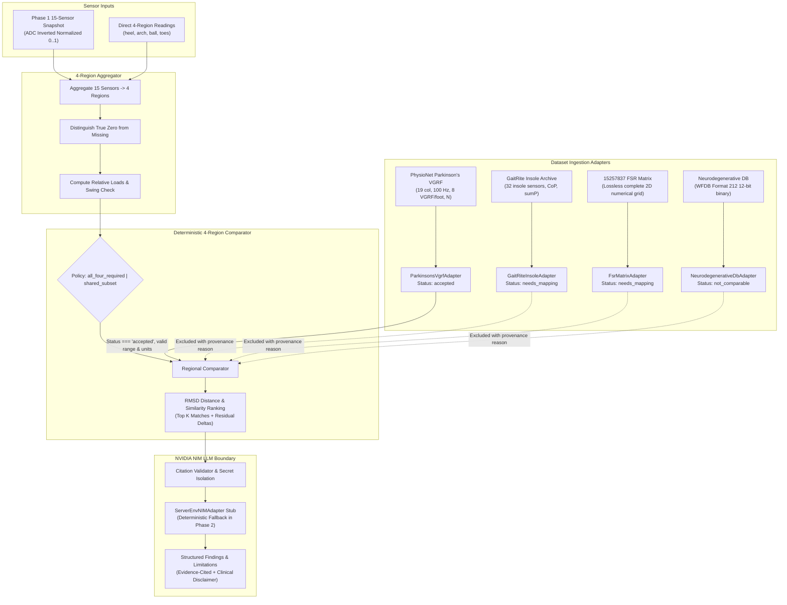

# Velostat Pressure Analysis — Phase 2 Dataset Adapters & 4-Region Architecture Specification

This specification documents the dataset ingestion adapters, four-region spatial mapping rules, deterministic comparison engine, NVIDIA NIM adapter boundary, hardware channel reconciliation, and clinical disclaimers for Phase 2 of the Velostat Plantar Pressure Mapping project.

---

## 1. Executive Summary & Product Regions

The Velostat Plantar Pressure Mapping product organizes the human plantar surface into four primary anatomical zones:
- **Heel** (`heel`): Calcaneus area (posterior contact).
- **Arch** (`arch`): Medial and lateral midfoot region (longitudinal arch).
- **Ball** (`ball`): Metatarsal heads 1 through 5 (forefoot transverse arch).
- **Toes** (`toes`): Hallux (big toe) and phalanges 2 through 5.

Phase 2 establishes a decoupled, deterministic analysis layer that ingests external reference datasets, standardizes them into an internal shared schema, and only enables numerical pattern comparisons where physical sensor geometry and authoritative documentation validate regional alignment.

---

## 2. Ingested Datasets & Scientific Mapping Justifications

Four reference datasets from local archives were analyzed, documented, and provided with dedicated ingestion adapters.

### 2.1 PhysioNet Gait in Parkinson's Disease (`gait-in-parkinsons-disease-1.0.0.zip`)
- **Adapter**: [`ParkinsonsVgrfAdapter`](file:///C:/Users/haard/.gemini/antigravity/scratch/velostat-pressure-viz/src/analysis/adapters/parkinsons_vgrf_adapter.js)
- **Source Format**: 19-column ASCII text files sampled at 100 Hz.
  - Column 0: Elapsed time in seconds.
  - Columns 1–8: Left foot vertical ground reaction force (VGRF) in Newtons (channels L1 to L8).
  - Columns 9–16: Right foot VGRF in Newtons (channels R1 to R8).
  - Column 17: Left foot total force reported by recorder.
  - Column 18: Right foot total force reported by recorder.
- **Physical Sensor Layout**:
  Authoritative coordinates are documented in PhysioNet `format.txt` for Ultraflex / Infotronic shoe-insole sensor systems:
  - $Y = -800, -400$: Sensors L1–L3 / R1–R3
  - $Y = 0$: Sensors L4–L5 / R4–R5
  - $Y = 400$: Sensors L6–L7 / R6–R7
  - $Y = 800$: Sensor L8 / R8
- **Project-Defined Coordinate Heuristic**:
  The PhysioNet source documents $(X, Y)$ coordinates, but grouping them into `heel`, `arch`, `ball`, and `toes` is a **project-defined coordinate heuristic**, not an author-defined anatomical segmentation.
  - **Heuristic Assumptions**:
    - $Y \le -400$ mm approximates calcaneal rearfoot (`heel`).
    - $Y = 0$ mm approximates midfoot longitudinal arch (`arch`).
    - $Y = 400$ mm approximates metatarsal head forefoot (`ball`).
    - $Y = 800$ mm approximates distal hallux (`toes`).
  - **Heuristic Limits**:
    - Hardware utilized 8 discrete point sensors, not a continuous planar array.
    - Regional partitions use fixed rectangular coordinate bands rather than subject-specific anthropometrics.
    - Source values represent vertical ground reaction force (VGRF) in **Newtons (N)**, not pressure.
    - Derived regional values represent **relative load proportions** ($\sum = 1.0$), which are distinct from physical pressure in kPa or $\text{N/cm}^2$ because sensor contact areas are not measured or calibrated.
  - **Left and Right Feet**: Kept strictly separated.
- **Comparability State**: **`accepted`**.
  Forces in Newtons are preserved in `original_values`. Relative load percentages are derived and stored in `regional_values` with `regional_units: 'relative_load_pct'`. Unloaded swing phases ($\text{total force} < 0.5\text{ N}$) are marked unloaded ($\text{relative load} = 0.0$).

### 2.2 GaitRite Insole Dataset (`insole-gaitrite-dataset.zip`)
- **Adapter**: [`GaitRiteInsoleAdapter`](file:///C:/Users/haard/.gemini/antigravity/scratch/velostat-pressure-viz/src/analysis/adapters/gaitrite_insole_adapter.js)
- **Source Format**: Insole sensor CSVs (`L.csv`, `R.csv`), GaitRite electronic walkway mat events (`gaitrite_test.csv`), and synchronization JSON (`sync_auto.json`). Video files (`.mp4`) are explicitly excluded.
- **Sensor Configuration**: 32 pressure sensor columns (`PressureSensor 0` to `PressureSensor 31`), 3-axis accelerometer, Center of Pressure (`copX`, `copY`), and sum pressure (`sumP`).
- **Comparability State**: **`needs_mapping`**.
  - **Scientific Rationale**: The archive documentation does not provide physical $(X, Y)$ coordinate matrices or an anatomical assignment diagram for the 32 numbered sensors. Assigning sensors $0\dots 31$ to heel/arch/ball/toes without sensor geometry would be arbitrary.
  - **Mat Events**: Semicolon-delimited temporal-spatial mat parameters (`gaitrite_test.csv`) record stride velocity, step length, and contact durations, marked **`not_comparable`** for continuous pressure distribution.

### 2.3 FSR Matrix Dataset (`15257837.zip`)
- **Adapter**: [`FsrMatrixAdapter`](file:///C:/Users/haard/.gemini/antigravity/scratch/velostat-pressure-viz/src/analysis/adapters/fsr_matrix_adapter.js)
- **Source Format**: Nested inside `2. FSR_DATASET_FV.zip`. Interpolated 2D numerical grids preceded by timestamp identifiers (`MAP__DD_MM_YYYY__HH_MM_SS`) and metadata header rows.
- **Preservation & Column Shifting Rules**:
  - **Lossless Matrix Preservation**: The complete 2D numerical matrix is preserved in full on `res.matrix` and `rec.original_values.matrix`. It is never discarded or truncated to sample rows.
  - **No Column Shifting**: Empty cells are never filtered out in a way that shifts column positions. If an empty cell is encountered, it is flagged and quarantined; empty cells are never coerced to zero.
  - **Dimension Validation**: Every row is strictly validated against `expectedCols`. Ragged or mismatched rows are quarantined with descriptive reasons.
- **Comparability State**: **`needs_mapping`** and **`not_comparable`**.
  - **Scientific Rationale**: The dataset contains arbitrary interpolation values without calibrated physical units (kPa or N) and lacks documented foot registration coordinates. Regional pressure comparison remains disabled until units and spatial coordinates are established.

### 2.4 PhysioNet Gait Dynamics in Neurodegenerative Disease (`gait-in-neurodegenerative-disease-database-1.0.0.zip`)
- **Adapter**: [`NeurodegenerativeDbAdapter`](file:///C:/Users/haard/.gemini/antigravity/scratch/velostat-pressure-viz/src/analysis/adapters/neurodegenerative_db_adapter.js)
- **Source Format**: PhysioNet WFDB format:
  - `.let` / `.rit`: Binary signal files packed in WFDB Format 212 (12-bit two's-complement packed integers).
  - `.hea`: ASCII header files with signal count, gains, baselines, and sample rates (typically 300 Hz).
  - `.ts`: 13-column tab-delimited stride interval metrics (stride interval, swing time, stance time).
- **Format 212 Decoder**: Decodes 3-byte binary triplets into two signed 12-bit integer amplitudes with appropriate sign extension.
- **Comparability State**: **`not_comparable`**.
  - **Scientific Rationale**: The hardware employed in this study (force transducers under the shoe) measured a **single aggregate vertical ground reaction force per foot**, rather than multi-zone spatial pressure. While temporal stride dynamics are successfully ingested, spatial four-region pressure comparisons are withheld.

---

## 3. Four-Region Aggregation & Deterministic Comparator

The four-region deterministic comparator ([`src/analysis/regional_comparator.js`](file:///C:/Users/haard/.gemini/antigravity/scratch/velostat-pressure-viz/src/analysis/regional_comparator.js)) bridges incoming sensor readings with reference records.

### 3.1 Sensor-to-Region Mapping Matrix
Phase 1 established 15 fixed sensor locations across the plantar right foot. The comparator aggregates these 15 sensors into the 4 product regions:

| Product Region | Phase 1 Sensor IDs | Anatomical Rationale |
| :--- | :--- | :--- |
| **`heel`** | `heel_medial`, `heel_center`, `heel_lateral` | Calcaneal body and medial/lateral tuberosities |
| **`arch`** | `arch_medial`, `midfoot_center`, `arch_lateral` | Navicular, cuneiforms, cuboid, and midfoot base |
| **`ball`** | `meta_1`, `meta_2`, `meta_3`, `meta_5` | Metatarsal heads I, II, III, and V (transverse forefoot arch) |
| **`toes`** | `toe_1`, `toe_2`, `toe_3`, `toe_4`, `toe_5` | Hallux and lesser digits 2–5 |

### 3.2 Distinguishing Measured Zeros from Missing/Unmapped Regions
- **True Measured Zero (`0.0`)**: A valid measurement indicating zero pressure detected on that region. `isMeasured: true`, `isZero: true`, `rawSum: 0.0`, `relativeLoad: 0.0`.
- **Missing / Unmapped Region**: No sensor was present, or the reading was `null`/`undefined`. `isMeasured: false`, `rawSum: null`, `relativeLoad: null`. **Missing inputs are NEVER coerced to zero.**

### 3.3 Explicit Comparison Policies
Comparison behavior is governed by documented, non-silent policies:

1. **`all_four_required` (Default Policy)**:
   - Both the incoming input and reference records must have all four valid measured regions (`heel`, `arch`, `ball`, `toes`).
   - If any region is missing or invalid on the incoming reading, comparison returns `status: insufficient_data` without silently scoring across the remaining regions.
   - Any candidate record lacking all four regions is excluded.
2. **`shared_subset`**:
   - Compares the exact same subset of measured regions that are valid on both sides.
   - Enforces a documented minimum number of shared regions (`minActiveRegions`, default: 3).
   - Re-normalizes relative loads over the shared subset on both sides so comparison is mathematically fair and on an identical basis.
   - Reports `compared_regions`, `uncompared_regions`, and `shared_region_coverage` (e.g. 0.75 for 3 regions).
   - Uncompared regions have delta `null`.

### 3.4 Strict Candidate Record Validation
Before scoring, reference records must satisfy all of the following criteria:
1. **Status**: Must be **exactly** `ADAPTER_STATUS.ACCEPTED` (`'accepted'`). Misspelled (`'ACCEPTED'`), unknown (`'pending'`), or missing statuses are rejected and recorded in `excluded_records_summary.invalid_status_count`.
2. **Units**: Must be **`'relative_load_pct'`**. Incompatible units (`'N'`, `'kPa'`, `'raw_counts'`) are rejected and recorded in `excluded_records_summary.incompatible_units_count`.
3. **Values & Range**: All regional values must be finite numbers in $[0.0, 1.0]$. Values outside $[0.0, 1.0]$, NaN, or Infinity are rejected and recorded in `excluded_records_summary.invalid_values_count`.
4. **Deterministic Ranking**:
   - Primary: `similarity_score` descending
   - Secondary: `rmsd_distance` ascending
   - Tertiary (Tie-breaker): `source_record_id` ascending (lexicographical)

---

## 4. Hardware Channel Reconciliation

A crucial architectural finding of Phase 2 is the reconciliation between the Phase 1 visualization canvas and the physical hardware:
- **Firmware Reality**: [`esp32_velostat.ino`](file:///C:/Users/haard/.gemini/antigravity/scratch/velostat-pressure-viz/esp32_velostat.ino) reads a single analog pin (`GPIO32`), transmitting a single integer per sample.
- **Serial Parser Reality**: [`script.js`](file:///C:/Users/haard/.gemini/antigravity/scratch/velostat-pressure-viz/script.js) routes this single reading to `state.hwMappedSensorId` (default: `heel_center`). The remaining 14 sensors do not receive hardware data.
- **Physical Channels**: The current hardware supplies **exactly ONE physical channel**, not 4 or 15 channels.
- **Analysis Layer Enforcement**: When evaluating a hardware stream with only 1 measured channel, `regional_comparator` returns `status: ANALYSIS_STATUS.INSUFFICIENT_DATA`:
  > *"Current hardware stream supplies only 1 physical sensor channel (GPIO32), but a 4-region planar comparison requires multi-channel measurements across at least 3 regions. Single-channel inputs cannot establish planar pressure distribution."*
- **Phase 1 UI Integrity**: The 15-sensor SVG/canvas rendering remains an interactive anatomical model, not an assertion of 15 physical hardware ADC lines.

---

## 5. NVIDIA NIM LLM Boundary & Phase 2 Stub Status

The NVIDIA NIM adapter ([`src/analysis/nvidia_nim_adapter.js`](file:///C:/Users/haard/.gemini/antigravity/scratch/velostat-pressure-viz/src/analysis/nvidia_nim_adapter.js)) provides an isolated interface for language model interpretation.

### 5.1 Phase 2 Secure Stub Status
- `ServerEnvNIMAdapter` is currently a **secure adapter stub** that returns deterministic fallback output.
- It **DOES NOT** call NVIDIA NIM or make live external network requests, even when an API key is configured in `process.env.NVIDIA_NIM_API_KEY`.
- Live remote API integration belongs exclusively to Phase 4 (backend integration).

### 5.2 Secret Isolation Guarantees
- The API key is read strictly from `process.env.NVIDIA_NIM_API_KEY` (or `process.env.NVIDIA_API_KEY`).
- Keys are held in a private, non-enumerable symbol (`API_KEY_SYMBOL`).
- The adapter suppresses key exposure in `Object.keys()`, `console.log()`, `JSON.stringify()`, stack traces, or response payloads.

### 5.3 Strict Citation Enforcement
- The language model **never** calculates similarity scores or selects matched templates.
- Any record ID cited in `cited_record_ids` **must strictly exist** in the comparison evidence produced by the comparator.
- Unmatched or hallucinated citations (e.g., `NIM-FABRICATED-REC-404`) are automatically stripped, counted in `rejected_citations_count`, and documented under `uncertainty_limitations`.

---

## 6. Non-Diagnostic Medical Disclaimer

All Phase 2 outputs include the following non-diagnostic disclaimer:

> **Notice**: Findings are numerical dataset comparisons based on sensor readings and reference templates. This system does not provide medical diagnoses or clinical advice.
